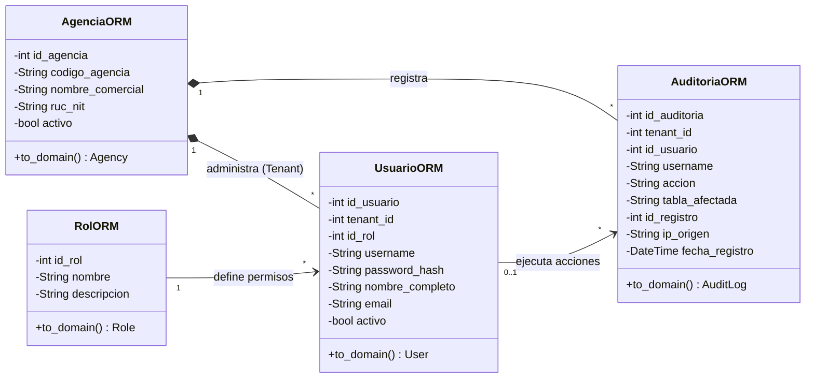
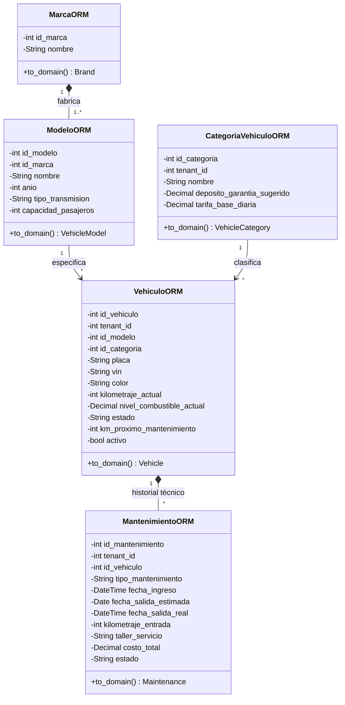
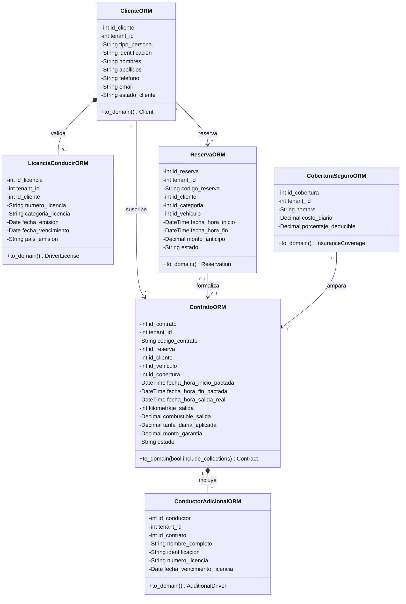
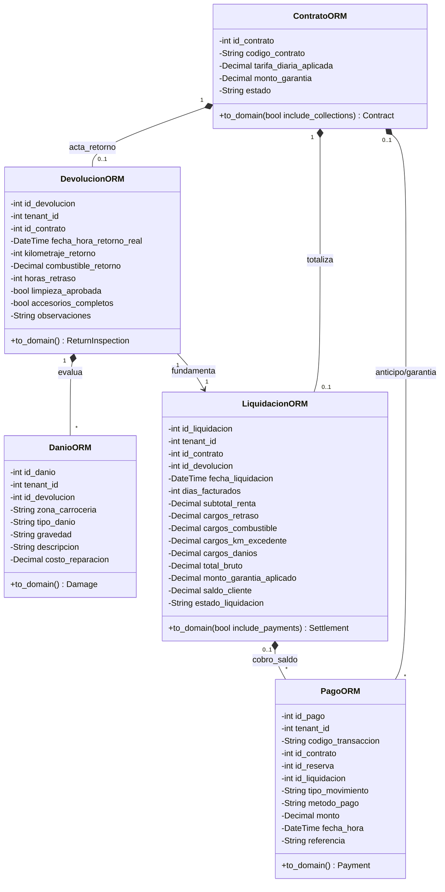

# Diagrama de Clases del ORM - AutoRent Pro

Documentación técnica y pedagógica del modelo relacional de objetos (**Object-Relational Mapping - ORM**) implementado con **SQLAlchemy 2.0** en PostgreSQL para el sistema **AutoRent Pro**. 

Este modelado cumple rigurosamente con los lineamientos de la **Guía Didáctica de Diagramas de Clases (UNAN)**:
* **Anatomía de Clase Estándar:** Nombre en `CamelCase`, atributos con visibilidad privada (`-`) y tipado explícito, operaciones públicas (`+`) con firma de dominio.
* **Tipos de Relación UML:** Generalización/Herencia (`<|--`), Composición con ciclo de vida dependiente (`*--`), y Asociación dirigida con multiplicidad (`-->`).
* **Arquitectura Multi-Inquilino (Multi-Tenancy con RLS):** Todas las tablas operativas contienen `tenant_id` hacia `agencias.id_agencia` garantizando aislamiento lógico a nivel de base de datos.
* **Mapeo a Entidades de Dominio:** Cada clase ORM implementa el método `+to_domain()` desacoplando el almacenamiento relacional de las reglas de negocio en [`src/domain/models.py`](file:///C:/Disk_E/UNAN/Proyecto_Integrador_II/agencia_de_autos/src/domain/models.py).

---

## 1. Diagrama Global del Sistema ORM

El siguiente diagrama representa de manera integral las 19 clases ORM, la superclase declarativa `Base`, sus atributos tipados, métodos y sus relaciones estructurales.

```mermaid
---
title: Diagrama Integral de Clases ORM (SQLAlchemy 2.0 / PostgreSQL)
---
classDiagram
  direction TB

  %% Clase Base Declarativa
  class Base {
    <<DeclarativeBase>>
    +metadata MetaData
    +registry Registry
  }

  %% Módulo 0: Multi-Tenancy
  class AgenciaORM {
    -int id_agencia
    -String codigo_agencia
    -String nombre_comercial
    -String ruc_nit
    -String telefono
    -String email
    -String direccion
    -bool activo
    -DateTime fecha_creacion
    +to_domain() Agency
  }
  Base <|-- AgenciaORM : hereda

  %% Módulo 1: Seguridad y Auditoría
  class RolORM {
    -int id_rol
    -String nombre
    -String descripcion
    +to_domain() Role
  }
  Base <|-- RolORM : hereda

  class UsuarioORM {
    -int id_usuario
    -int tenant_id
    -int id_rol
    -String username
    -String password_hash
    -String nombre_completo
    -String email
    -bool activo
    -DateTime fecha_creacion
    +to_domain() User
  }
  Base <|-- UsuarioORM : hereda

  class AuditoriaORM {
    -int id_auditoria
    -int tenant_id
    -int id_usuario
    -String username
    -String accion
    -String tabla_afectada
    -int id_registro
    -String detalles
    -String ip_origen
    -DateTime fecha_registro
    +to_domain() AuditLog
  }
  Base <|-- AuditoriaORM : hereda

  %% Módulo 2: Flota y Vehículos
  class MarcaORM {
    -int id_marca
    -String nombre
    +to_domain() Brand
  }
  Base <|-- MarcaORM : hereda

  class ModeloORM {
    -int id_modelo
    -int id_marca
    -String nombre
    -int anio
    -String tipo_transmision
    -int capacidad_pasajeros
    +to_domain() VehicleModel
  }
  Base <|-- ModeloORM : hereda

  class CategoriaVehiculoORM {
    -int id_categoria
    -int tenant_id
    -String nombre
    -String descripcion
    -Decimal deposito_garantia_sugerido
    -Decimal tarifa_base_diaria
    +to_domain() VehicleCategory
  }
  Base <|-- CategoriaVehiculoORM : hereda

  class VehiculoORM {
    -int id_vehiculo
    -int tenant_id
    -int id_modelo
    -int id_categoria
    -String placa
    -String vin
    -String color
    -int kilometraje_actual
    -Decimal nivel_combustible_actual
    -String estado
    -int km_proximo_mantenimiento
    -bool activo
    +to_domain() Vehicle
  }
  Base <|-- VehiculoORM : hereda

  %% Módulo 3: Clientes y Conductores
  class ClienteORM {
    -int id_cliente
    -int tenant_id
    -String tipo_persona
    -String identificacion
    -String nombres
    -String apellidos
    -String telefono
    -String email
    -String direccion
    -String estado_cliente
    -DateTime fecha_registro
    +to_domain() Client
  }
  Base <|-- ClienteORM : hereda

  class LicenciaConducirORM {
    -int id_licencia
    -int tenant_id
    -int id_cliente
    -String numero_licencia
    -String categoria_licencia
    -Date fecha_emision
    -Date fecha_vencimiento
    -String pais_emision
    +to_domain() DriverLicense
  }
  Base <|-- LicenciaConducirORM : hereda

  class CoberturaSeguroORM {
    -int id_cobertura
    -int tenant_id
    -String nombre
    -String descripcion
    -Decimal costo_diario
    -Decimal porcentaje_deducible
    +to_domain() InsuranceCoverage
  }
  Base <|-- CoberturaSeguroORM : hereda

  %% Módulo 4: Reservas
  class ReservaORM {
    -int id_reserva
    -int tenant_id
    -String codigo_reserva
    -int id_cliente
    -int id_categoria
    -int id_vehiculo
    -DateTime fecha_hora_inicio
    -DateTime fecha_hora_fin
    -Decimal monto_anticipo
    -String estado
    -int id_usuario
    -DateTime fecha_creacion
    +to_domain() Reservation
  }
  Base <|-- ReservaORM : hereda

  %% Módulo 5: Contratos y Operaciones
  class ContratoORM {
    -int id_contrato
    -int tenant_id
    -String codigo_contrato
    -int id_reserva
    -int id_cliente
    -int id_vehiculo
    -int id_cobertura
    -DateTime fecha_hora_inicio_pactada
    -DateTime fecha_hora_fin_pactada
    -DateTime fecha_hora_salida_real
    -int kilometraje_salida
    -Decimal combustible_salida
    -Decimal tarifa_diaria_aplicada
    -Decimal monto_garantia
    -bool kilometraje_ilimitado
    -int limite_km_diario
    -Decimal costo_km_excedente
    -String estado
    -int id_usuario
    -DateTime fecha_creacion
    +to_domain(bool include_collections) Contract
  }
  Base <|-- ContratoORM : hereda

  class ConductorAdicionalORM {
    -int id_conductor
    -int tenant_id
    -int id_contrato
    -String nombre_completo
    -String identificacion
    -String numero_licencia
    -Date fecha_vencimiento_licencia
    +to_domain() AdditionalDriver
  }
  Base <|-- ConductorAdicionalORM : hereda

  %% Módulo 6: Devoluciones y Daños
  class DevolucionORM {
    -int id_devolucion
    -int tenant_id
    -int id_contrato
    -DateTime fecha_hora_retorno_real
    -int kilometraje_retorno
    -Decimal combustible_retorno
    -int horas_retraso
    -bool limpieza_aprobada
    -bool accesorios_completos
    -String observaciones
    -int id_usuario
    +to_domain() ReturnInspection
  }
  Base <|-- DevolucionORM : hereda

  class DanioORM {
    -int id_danio
    -int tenant_id
    -int id_devolucion
    -String zona_carroceria
    -String tipo_danio
    -String gravedad
    -String descripcion
    -Decimal costo_reparacion
    +to_domain() Damage
  }
  Base <|-- DanioORM : hereda

  %% Módulo 7: Liquidaciones y Finanzas
  class LiquidacionORM {
    -int id_liquidacion
    -int tenant_id
    -int id_contrato
    -int id_devolucion
    -DateTime fecha_liquidacion
    -int dias_facturados
    -Decimal subtotal_renta
    -Decimal cargos_retraso
    -Decimal cargos_combustible
    -Decimal cargos_km_excedente
    -Decimal cargos_danios
    -Decimal total_bruto
    -Decimal monto_garantia_aplicado
    -Decimal saldo_cliente
    -String estado_liquidacion
    -int id_usuario
    +to_domain(bool include_payments) Settlement
  }
  Base <|-- LiquidacionORM : hereda

  class PagoORM {
    -int id_pago
    -int tenant_id
    -String codigo_transaccion
    -int id_contrato
    -int id_reserva
    -int id_liquidacion
    -String tipo_movimiento
    -String metodo_pago
    -Decimal monto
    -DateTime fecha_hora
    -String referencia
    -int id_usuario
    +to_domain() Payment
  }
  Base <|-- PagoORM : hereda

  %% Módulo 8: Mantenimiento
  class MantenimientoORM {
    -int id_mantenimiento
    -int tenant_id
    -int id_vehiculo
    -String tipo_mantenimiento
    -DateTime fecha_ingreso
    -Date fecha_salida_estimada
    -DateTime fecha_salida_real
    -int kilometraje_entrada
    -String taller_servicio
    -String descripcion_trabajo
    -Decimal costo_total
    -String estado
    -int id_usuario
    +to_domain() Maintenance
  }
  Base <|-- MantenimientoORM : hereda

  %% Relaciones Estructurales y Multiplicidades
  AgenciaORM "1" *-- "*" UsuarioORM : administra
  RolORM "1" --> "*" UsuarioORM : asigna
  UsuarioORM "0..1" --> "*" AuditoriaORM : audita

  MarcaORM "1" *-- "1..*" ModeloORM : cataloga
  ModeloORM "1" --> "*" VehiculoORM : especifica
  CategoriaVehiculoORM "1" --> "*" VehiculoORM : clasifica
  VehiculoORM "1" *-- "*" MantenimientoORM : somete_a

  ClienteORM "1" *-- "0..1" LicenciaConducirORM : posee
  ClienteORM "1" --> "*" ReservaORM : solicita
  ClienteORM "1" --> "*" ContratoORM : arrienda

  CategoriaVehiculoORM "1" --> "*" ReservaORM : requiere
  VehiculoORM "0..1" --> "*" ReservaORM : preasigna
  ReservaORM "0..1" --> "0..1" ContratoORM : formaliza

  VehiculoORM "1" --> "*" ContratoORM : asignado_a
  CoberturaSeguroORM "1" --> "*" ContratoORM : protege
  ContratoORM "1" *-- "*" ConductorAdicionalORM : incluye
  ContratoORM "1" *-- "0..1" DevolucionORM : acta_retorno
  DevolucionORM "1" *-- "*" DanioORM : evalua
  ContratoORM "1" *-- "0..1" LiquidacionORM : totaliza
  DevolucionORM "1" --> "1" LiquidacionORM : sustenta

  ContratoORM "0..1" *-- "*" PagoORM : cobra_contrato
  ReservaORM "0..1" --> "*" PagoORM : anticipo
  LiquidacionORM "0..1" *-- "*" PagoORM : cobra_saldo
  UsuarioORM "1" --> "*" PagoORM : procesa
  UsuarioORM "1" --> "*" ContratoORM : gestiona
  UsuarioORM "1" --> "*" ReservaORM : recepciona
  UsuarioORM "1" --> "*" DevolucionORM : inspecciona
  UsuarioORM "1" --> "*" LiquidacionORM : emite
  UsuarioORM "1" --> "*" MantenimientoORM : supervisa
```

---

## 2. Diagramas Modulares de Profundización

Para facilitar la lectura técnica y la evaluación académica según la guía de la UNAN, el modelo se subdivide en 4 diagramas temáticos de alta legibilidad:

### 2.1. Módulo de Seguridad, Multi-Tenancy y Auditoría

Modelado de la gobernanza de accesos (RBAC), control de inquilinos y bitácora inmutable de eventos.

---

### 2.2. Módulo de Flota, Catálogo y Mantenimiento de Vehículos

Control del inventario de unidades automotrices, su categorización tarifaria y el historial técnico en taller.

---

### 2.3. Módulo de Clientes, Reservas y Contratos de Alquiler

Flujo operativo comercial: desde la reserva preventiva hasta la formalización del contrato con conductores adicionales y seguro.

---

### 2.4. Módulo de Inspección de Devolución, Liquidación y Pagos

Cierre del ciclo de alquiler: inspección física de retorno, levantamiento de averías, cálculo financiero final y registro de pagos.

---

## 3. Diccionario de Clases ORM y Metodología UNAN

A continuación se detalla la matriz técnica de cada una de las 19 clases ORM implementadas en [`src/database/orm_models.py`](file:///C:/Disk_E/UNAN/Proyecto_Integrador_II/agencia_de_autos/src/database/orm_models.py):

| # | Clase ORM | Tabla PostgreSQL | Responsabilidad en el Dominio | Método de Transformación | Relaciones UML Principales |
| :--- | :--- | :--- | :--- | :--- | :--- |
| **0** | `Base` | N/A (Declarative) | Superclase declarativa de SQLAlchemy 2.0 que gestiona el `MetaData` y registro de mapeo relacional. | N/A | Generalización raíz (`<|--`) de las 19 clases ORM. |
| **1** | `AgenciaORM` | `agencias` | Inquilino raíz (Tenant Root). Representa las sucursales del sistema y aplica el contexto RLS. | `+to_domain() Agency` | Composición (`*--`) hacia `UsuarioORM`, agregación sobre entidades multi-tenant. |
| **2** | `RolORM` | `roles` | Catálogo RBAC (`ADMINISTRADOR`, `GERENTE`, `AGENTE_VENTAS`, `INSPECTOR_TALLER`). | `+to_domain() Role` | Asociación (`-->`) `1` a `*` con `UsuarioORM`. |
| **3** | `UsuarioORM` | `usuarios` | Cuentas de usuario autenticadas por inquilino con roles y credenciales seguras (Argon2/Bcrypt). | `+to_domain() User` | Asociación con `RolORM`, `AgenciaORM` y generador de `AuditoriaORM`. |
| **4** | `AuditoriaORM` | `auditoria` | Pista de auditoría inmutable de eventos sensibles (RF-05). | `+to_domain() AuditLog` | Asociación con `UsuarioORM` (`0..1` a `*`). |
| **5** | `MarcaORM` | `marcas` | Catálogo global de fabricantes automotrices (Toyota, Hyundai, etc.). | `+to_domain() Brand` | Composición (`*--`) `1` a `1..*` con `ModeloORM`. |
| **6** | `ModeloORM` | `modelos` | Líneas de vehículos por marca con especificación de transmisión y capacidad. | `+to_domain() VehicleModel` | Asociación con `MarcaORM` y `VehiculoORM`. |
| **7** | `CategoriaVehiculoORM` | `categorias_vehiculo` | Clasificación tarifaria (Sedán Económico, SUV, etc.) y depósitos de garantía sugeridos. | `+to_domain() VehicleCategory` | Asociación con `VehiculoORM` y `ReservaORM`. |
| **8** | `VehiculoORM` | `vehiculos` | Unidad automotriz física con odómetro, combustible, estado de flota (`DISPONIBLE`, etc.) y VIN. | `+to_domain() Vehicle` | Composición con `MantenimientoORM`, asociación con `ReservaORM` y `ContratoORM`. |
| **9** | `ClienteORM` | `clientes` | Persona natural o jurídica titular de alquileres y reservas. | `+to_domain() Client` | Composición (`*--`) `1` a `0..1` con `LicenciaConducirORM`, asociación con `ReservaORM` y `ContratoORM`. |
| **10** | `LicenciaConducirORM` | `licencias_conducir` | Documento de habilitación de conducción con fechas de vencimiento y categoría. | `+to_domain() DriverLicense` | Dependencia fuerte (`*--`) con `ClienteORM` (`cascade="all, delete-orphan"`). |
| **11** | `CoberturaSeguroORM` | `coberturas_seguro` | Pólizas y coberturas de seguro (Básica, Full Cover, etc.) con deducibles. | `+to_domain() InsuranceCoverage` | Asociación con `ContratoORM`. |
| **12** | `ReservaORM` | `reservas` | Bloqueo preventivo de categoría/vehículo con fecha pactada y anticipo (RF-14). | `+to_domain() Reservation` | Asociación con `ClienteORM`, `CategoriaVehiculoORM`, `VehiculoORM` y `ContratoORM`. |
| **13** | `ContratoORM` | `contratos` | Contrato legal de alquiler con kilometraje y combustible de salida, garantía y tarifa pactada. | `+to_domain() Contract` | Composición con `ConductorAdicionalORM`, `DevolucionORM` y `LiquidacionORM`. |
| **14** | `ConductorAdicionalORM` | `conductores_adicionales` | Conductores legalmente autorizados bajo el amparo de la póliza del contrato. | `+to_domain() AdditionalDriver` | Composición (`*--`) con `ContratoORM` (`cascade="all, delete-orphan"`). |
| **15** | `DevolucionORM` | `devoluciones` | Acta física de recepción del vehículo (odómetro, combustible, horas de retraso y limpieza). | `+to_domain() ReturnInspection` | Composición con `DanioORM`, asociación biunívoca con `LiquidacionORM`. |
| **16** | `DanioORM` | `danios` | Detalle pericial de averías encontradas en carrocería e interiores con costo de reparación. | `+to_domain() Damage` | Composición (`*--`) con `DevolucionORM` (`cascade="all, delete-orphan"`). |
| **17** | `LiquidacionORM` | `liquidaciones` | Balance financiero final del contrato: cargos por mora, combustible, kilometraje y deducción de garantía. | `+to_domain() Settlement` | Composición con `PagoORM`, asociación con `DevolucionORM` y `ContratoORM`. |
| **18** | `PagoORM` | `pagos` | Movimiento de tesorería y caja (anticipos, garantías, liquidaciones y reembolsos). | `+to_domain() Payment` | Asociación con `ContratoORM`, `ReservaORM` y `LiquidacionORM`. |
| **19** | `MantenimientoORM` | `mantenimientos` | Órdenes de trabajo preventivo y correctivo en taller mecánico con control de costos y tiempos. | `+to_domain() Maintenance` | Composición (`*--`) con `VehiculoORM`. |

---

## 4. Convenciones de Modelado y Cumplimiento Normativo UNAN

1. **Visibilidad de Atributos (`-`) y Métodos (`+`):**
   * Todos los atributos de persistencia están tipados y declarados como privados (`-`), garantizando el principio de encapsulamiento.
   * Las operaciones de transformación de dominio (`+to_domain()`) son públicas (`+`) y devuelven tipos de entidades inmutables.
2. **Multiplicidades Formales:**
   * `1`: Exactamente un elemento obligatorio.
   * `0..1`: Elemento opcional (por ejemplo, vehículo asignado en reserva o liquidación en contrato activo).
   * `*` / `0..*`: Cero a muchos elementos.
   * `1..*`: Al menos uno a muchos (por ejemplo, una marca contiene al menos un modelo).
3. **Tipos de Datos UML Homologados:**
   * `BigInteger` $\rightarrow$ `int`
   * `String(N)` / `Text` $\rightarrow$ `String`
   * `Numeric(P, S)` $\rightarrow$ `Decimal`
   * `Boolean` $\rightarrow$ `bool`
   * `DateTime(timezone=True)` $\rightarrow$ `DateTime`
   * `Date` $\rightarrow$ `Date`

---

*Archivo de código fuente Mermaid puro disponible en:* [Diagrama_Clases_ORM.mmd](file:///C:/Disk_E/UNAN/Proyecto_Integrador_II/agencia_de_autos/docs/diagrams/clases_orm/Diagrama_Clases_ORM.mmd)
