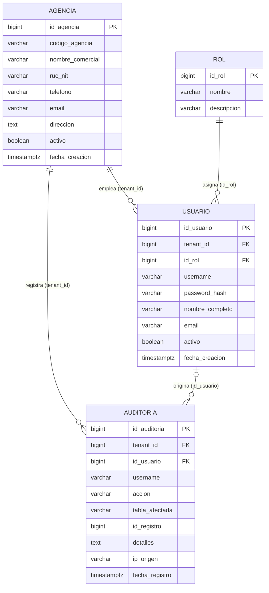
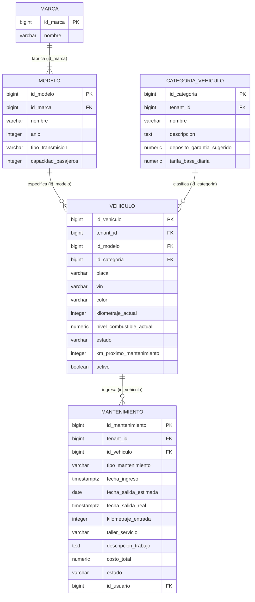
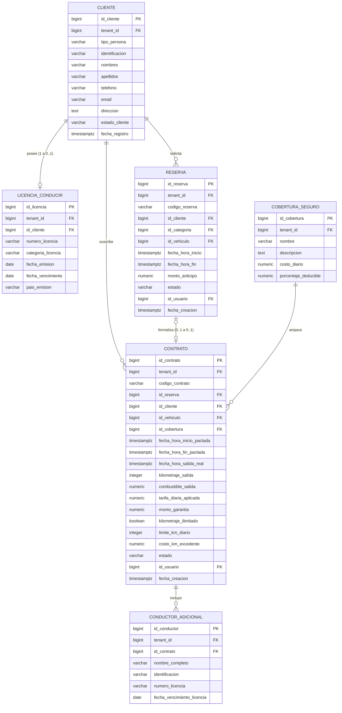
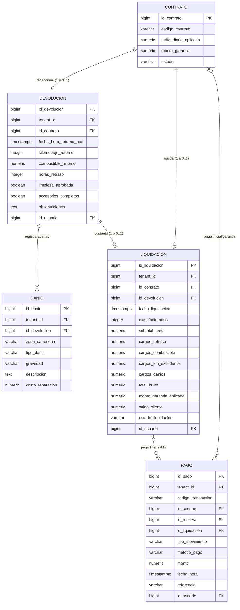

# Diagrama Entidad-Relación (ERD) - AutoRent Pro

Documentación técnica y conceptual del **Diagrama Entidad-Relación** que modela las **19 tablas del esquema relacional en PostgreSQL 15+** del sistema **AutoRent Pro**, conforme al script DDL oficial [`src/database/migrations/01_create_schema.sql`](file:///C:/Disk_E/UNAN/Proyecto_Integrador_II/agencia_de_autos/src/database/migrations/01_create_schema.sql).

El modelado aplica las mejores prácticas de la ingeniería de datos y la notación **Crow's Foot (Pata de Gallo)**:
* **Entidades en singular y mayúsculas:** Representan las instancias abstractas de los tipos de entidad (`AGENCIA`, `VEHICULO`, `CONTRATO`, etc.).
* **Tipado de Atributos:** Tipos de datos estandarizados (`bigint`, `varchar`, `numeric`, `boolean`, `timestamptz`, `date`, `text`).
* **Especificación de Claves:** Marcadores explícitos de Clave Primaria (`PK`) y Claves Foráneas (`FK`).
* **Cardinalidad Formal:**
  * `||--o{` : Uno a cero o muchos ($1 : 0..*$)
  * `||--|{` : Uno a uno o muchos ($1 : 1..*$)
  * `||--o|` : Uno a cero o uno ($1 : 0..1$)
  * `|o--o{` : Cero o uno a cero o muchos ($0..1 : 0..*$)
  * `|o--o|` : Cero o uno a cero o uno ($0..1 : 0..1$)
* **Patrón Multi-Inquilino (Multi-Tenancy con RLS):** Aislamiento de datos mediante `tenant_id` obligatorio en todas las entidades transaccionales referenciando a `AGENCIA`.

---

## 1. Diagrama ER Global (19 Entidades)

El siguiente diagrama integra la totalidad del ecosistema de datos del sistema, sus claves y relaciones de negocio.

```mermaid
---
title: Diagrama Entidad-Relación Integral (PostgreSQL 15+) - AutoRent Pro
---
erDiagram
    %% =========================================================================
    %% 0. MODULO MULTI-TENANCY
    %% =========================================================================
    AGENCIA {
        bigint id_agencia PK
        varchar codigo_agencia
        varchar nombre_comercial
        varchar ruc_nit
        varchar telefono
        varchar email
        text direccion
        boolean activo
        timestamptz fecha_creacion
    }

    %% =========================================================================
    %% 1. MODULO DE SEGURIDAD Y USUARIOS (RBAC)
    %% =========================================================================
    ROL {
        bigint id_rol PK
        varchar nombre
        varchar descripcion
    }

    USUARIO {
        bigint id_usuario PK
        bigint tenant_id FK
        bigint id_rol FK
        varchar username
        varchar password_hash
        varchar nombre_completo
        varchar email
        boolean activo
        timestamptz fecha_creacion
    }

    AUDITORIA {
        bigint id_auditoria PK
        bigint tenant_id FK
        bigint id_usuario FK
        varchar username
        varchar accion
        varchar tabla_afectada
        bigint id_registro
        text detalles
        varchar ip_origen
        timestamptz fecha_registro
    }

    %% =========================================================================
    %% 2. MODULO DE FLOTA Y VEHICULOS
    %% =========================================================================
    MARCA {
        bigint id_marca PK
        varchar nombre
    }

    MODELO {
        bigint id_modelo PK
        bigint id_marca FK
        varchar nombre
        integer anio
        varchar tipo_transmision
        integer capacidad_pasajeros
    }

    CATEGORIA_VEHICULO {
        bigint id_categoria PK
        bigint tenant_id FK
        varchar nombre
        text descripcion
        numeric deposito_garantia_sugerido
        numeric tarifa_base_diaria
    }

    VEHICULO {
        bigint id_vehiculo PK
        bigint tenant_id FK
        bigint id_modelo FK
        bigint id_categoria FK
        varchar placa
        varchar vin
        varchar color
        integer kilometraje_actual
        numeric nivel_combustible_actual
        varchar estado
        integer km_proximo_mantenimiento
        boolean activo
    }

    %% =========================================================================
    %% 3. MODULO DE CLIENTES Y CONDUCTORES
    %% =========================================================================
    CLIENTE {
        bigint id_cliente PK
        bigint tenant_id FK
        varchar tipo_persona
        varchar identificacion
        varchar nombres
        varchar apellidos
        varchar telefono
        varchar email
        text direccion
        varchar estado_cliente
        timestamptz fecha_registro
    }

    LICENCIA_CONDUCIR {
        bigint id_licencia PK
        bigint tenant_id FK
        bigint id_cliente FK
        varchar numero_licencia
        varchar categoria_licencia
        date fecha_emision
        date fecha_vencimiento
        varchar pais_emision
    }

    COBERTURA_SEGURO {
        bigint id_cobertura PK
        bigint tenant_id FK
        varchar nombre
        text descripcion
        numeric costo_diario
        numeric porcentaje_deducible
    }

    %% =========================================================================
    %% 4. MODULO DE RESERVAS
    %% =========================================================================
    RESERVA {
        bigint id_reserva PK
        bigint tenant_id FK
        varchar codigo_reserva
        bigint id_cliente FK
        bigint id_categoria FK
        bigint id_vehiculo FK
        timestamptz fecha_hora_inicio
        timestamptz fecha_hora_fin
        numeric monto_anticipo
        varchar estado
        bigint id_usuario FK
        timestamptz fecha_creacion
    }

    %% =========================================================================
    %% 5. MODULO DE CONTRATOS Y OPERACIONES
    %% =========================================================================
    CONTRATO {
        bigint id_contrato PK
        bigint tenant_id FK
        varchar codigo_contrato
        bigint id_reserva FK
        bigint id_cliente FK
        bigint id_vehiculo FK
        bigint id_cobertura FK
        timestamptz fecha_hora_inicio_pactada
        timestamptz fecha_hora_fin_pactada
        timestamptz fecha_hora_salida_real
        integer kilometraje_salida
        numeric combustible_salida
        numeric tarifa_diaria_aplicada
        numeric monto_garantia
        boolean kilometraje_ilimitado
        integer limite_km_diario
        numeric costo_km_excedente
        varchar estado
        bigint id_usuario FK
        timestamptz fecha_creacion
    }

    CONDUCTOR_ADICIONAL {
        bigint id_conductor PK
        bigint tenant_id FK
        bigint id_contrato FK
        varchar nombre_completo
        varchar identificacion
        varchar numero_licencia
        date fecha_vencimiento_licencia
    }

    %% =========================================================================
    %% 6. MODULO DE DEVOLUCIONES Y DAÑOS
    %% =========================================================================
    DEVOLUCION {
        bigint id_devolucion PK
        bigint tenant_id FK
        bigint id_contrato FK
        timestamptz fecha_hora_retorno_real
        integer kilometraje_retorno
        numeric combustible_retorno
        integer horas_retraso
        boolean limpieza_aprobada
        boolean accesorios_completos
        text observaciones
        bigint id_usuario FK
    }

    DANIO {
        bigint id_danio PK
        bigint tenant_id FK
        bigint id_devolucion FK
        varchar zona_carroceria
        varchar tipo_danio
        varchar gravedad
        text descripcion
        numeric costo_reparacion
    }

    %% =========================================================================
    %% 7. MODULO DE LIQUIDACIONES Y CONTROL FINANCIERO
    %% =========================================================================
    LIQUIDACION {
        bigint id_liquidacion PK
        bigint tenant_id FK
        bigint id_contrato FK
        bigint id_devolucion FK
        timestamptz fecha_liquidacion
        integer dias_facturados
        numeric subtotal_renta
        numeric cargos_retraso
        numeric cargos_combustible
        numeric cargos_km_excedente
        numeric cargos_danios
        numeric total_bruto
        numeric monto_garantia_aplicado
        numeric saldo_cliente
        varchar estado_liquidacion
        bigint id_usuario FK
    }

    PAGO {
        bigint id_pago PK
        bigint tenant_id FK
        varchar codigo_transaccion
        bigint id_contrato FK
        bigint id_reserva FK
        bigint id_liquidacion FK
        varchar tipo_movimiento
        varchar metodo_pago
        numeric monto
        timestamptz fecha_hora
        varchar referencia
        bigint id_usuario FK
    }

    %% =========================================================================
    %% 8. MODULO DE MANTENIMIENTO
    %% =========================================================================
    MANTENIMIENTO {
        bigint id_mantenimiento PK
        bigint tenant_id FK
        bigint id_vehiculo FK
        varchar tipo_mantenimiento
        timestamptz fecha_ingreso
        date fecha_salida_estimada
        timestamptz fecha_salida_real
        integer kilometraje_entrada
        varchar taller_servicio
        text descripcion_trabajo
        numeric costo_total
        varchar estado
        bigint id_usuario FK
    }

    %% =========================================================================
    %% RELACIONES FORMALES
    %% =========================================================================
    AGENCIA ||--o{ USUARIO : "emplea"
    AGENCIA ||--o{ AUDITORIA : "registra_eventos"
    ROL ||--o{ USUARIO : "asigna"
    USUARIO |o--o{ AUDITORIA : "origina"

    MARCA ||--|{ MODELO : "fabrica"
    MODELO ||--o{ VEHICULO : "especifica"
    CATEGORIA_VEHICULO ||--o{ VEHICULO : "clasifica"
    VEHICULO ||--o{ MANTENIMIENTO : "recibe"
    USUARIO ||--o{ MANTENIMIENTO : "supervisa"

    CLIENTE ||--o| LICENCIA_CONDUCIR : "posee"

    CLIENTE ||--o{ RESERVA : "solicita"
    CATEGORIA_VEHICULO ||--o{ RESERVA : "exige"
    VEHICULO |o--o{ RESERVA : "preasigna"
    USUARIO ||--o{ RESERVA : "registra"

    RESERVA |o--o| CONTRATO : "formaliza"
    CLIENTE ||--o{ CONTRATO : "suscribe"
    VEHICULO ||--o{ CONTRATO : "arrienda"
    COBERTURA_SEGURO ||--o{ CONTRATO : "ampara"
    USUARIO ||--o{ CONTRATO : "emite"
    CONTRATO ||--o{ CONDUCTOR_ADICIONAL : "autoriza"

    CONTRATO ||--o| DEVOLUCION : "recepciona"
    USUARIO ||--o{ DEVOLUCION : "inspecciona"
    DEVOLUCION ||--o{ DANIO : "constata"

    CONTRATO ||--o| LIQUIDACION : "liquida"
    DEVOLUCION ||--o| LIQUIDACION : "sustenta"
    USUARIO ||--o{ LIQUIDACION : "totaliza"

    CONTRATO |o--o{ PAGO : "abona"
    RESERVA |o--o{ PAGO : "anticipa"
    LIQUIDACION |o--o{ PAGO : "cancela"
    USUARIO ||--o{ PAGO : "recauda"
```

---

## 2. Diagramas ER Modulares de Profundización

Para exposiciones académicas y revisión técnica, se desglosan los 4 subsistemas funcionales:

### 2.1. Módulo de Multi-Tenancy, Seguridad y Auditoría (RBAC)

Aislamiento de sedes mediante `AGENCIA`, asignación de privilegios `ROL` a `USUARIO`, y registro de eventos inmutables en `AUDITORIA`.

---

### 2.2. Módulo de Flota, Catálogo y Mantenimiento de Vehículos

Clasificación jerárquica de unidades (`MARCA` $\rightarrow$ `MODELO` $\rightarrow$ `VEHICULO`), tarifas en `CATEGORIA_VEHICULO` y órdenes en `MANTENIMIENTO`.

---

### 2.3. Módulo de Clientes, Reservas y Contratos de Alquiler

Ciclo comercial previo y formalización: `CLIENTE` y `LICENCIA_CONDUCIR`, anticipo en `RESERVA`, y contrato legal en `CONTRATO` con `CONDUCTOR_ADICIONAL` y `COBERTURA_SEGURO`.

---

### 2.4. Módulo de Inspección de Retorno, Liquidación Financiera y Caja

Cierre operativo del servicio: recepción física en `DEVOLUCION`, peritaje en `DANIO`, facturación en `LIQUIDACION` y tesorería en `PAGO`.

---

## 3. Matriz de Entidades y Cardinalidades de Base de Datos

| # | Entidad ER | Tabla SQL | Clave Primaria (PK) | Claves Foráneas (FK) | Restricciones e Integridad Notables |
| :--- | :--- | :--- | :--- | :--- | :--- |
| **1** | `AGENCIA` | `agencias` | `id_agencia` | *Ninguna (Raíz)* | `codigo_agencia UNIQUE`, `ruc_nit UNIQUE`. Inquilino raíz de la arquitectura RLS. |
| **2** | `ROL` | `roles` | `id_rol` | *Ninguna* | `nombre UNIQUE`, `CHECK (nombre IN ('ADMINISTRADOR', ...))`. |
| **3** | `USUARIO` | `usuarios` | `id_usuario` | `tenant_id`, `id_rol` | `UNIQUE(tenant_id, username)`, `UNIQUE(tenant_id, email)`. |
| **4** | `AUDITORIA` | `auditoria` | `id_auditoria` | `tenant_id`, `id_usuario` | Inmutable. `id_usuario ON DELETE SET NULL` para preservar auditoría si se borra el usuario. |
| **5** | `MARCA` | `marcas` | `id_marca` | *Ninguna* | `nombre UNIQUE`. Catálogo global común a todas las agencias. |
| **6** | `MODELO` | `modelos` | `id_modelo` | `id_marca` | `UNIQUE(id_marca, nombre, anio)`, `CHECK (tipo_transmision IN ('MANUAL', 'AUTOMATICA'))`. |
| **7** | `CATEGORIA_VEHICULO` | `categorias_vehiculo` | `id_categoria` | `tenant_id` | `UNIQUE(tenant_id, nombre)`, `CHECK (tarifa_base_diaria > 0)`. |
| **8** | `VEHICULO` | `vehiculos` | `id_vehiculo` | `tenant_id`, `id_modelo`, `id_categoria` | `UNIQUE(tenant_id, placa)`, `UNIQUE(tenant_id, vin)`, `CHECK (combustible 0..1)`. |
| **9** | `CLIENTE` | `clientes` | `id_cliente` | `tenant_id` | `UNIQUE(tenant_id, identificacion)`, `UNIQUE(tenant_id, email)`. |
| **10** | `LICENCIA_CONDUCIR` | `licencias_conducir` | `id_licencia` | `tenant_id`, `id_cliente` | `id_cliente UNIQUE`, `ON DELETE CASCADE`, `CHECK (vencimiento > emision)`. |
| **11** | `COBERTURA_SEGURO` | `coberturas_seguro` | `id_cobertura` | `tenant_id` | `UNIQUE(tenant_id, nombre)`, `CHECK (deducible BETWEEN 0 AND 100)`. |
| **12** | `RESERVA` | `reservas` | `id_reserva` | `tenant_id`, `id_cliente`, `id_categoria`, `id_vehiculo`, `id_usuario` | `EXCLUDE USING gist`: Bloqueo anti-overbooking por rango temporal de vehículo. |
| **13** | `CONTRATO` | `contratos` | `id_contrato` | `tenant_id`, `id_reserva`, `id_cliente`, `id_vehiculo`, `id_cobertura`, `id_usuario` | `EXCLUDE USING gist`: Imposible solapar alquileres del mismo vehículo. |
| **14** | `CONDUCTOR_ADICIONAL` | `conductores_adicionales` | `id_conductor` | `tenant_id`, `id_contrato` | `id_contrato ON DELETE CASCADE`. |
| **15** | `DEVOLUCION` | `devoluciones` | `id_devolucion` | `tenant_id`, `id_contrato`, `id_usuario` | `id_contrato UNIQUE`. Acta física obligatoria para liquidar. |
| **16** | `DANIO` | `danios` | `id_danio` | `tenant_id`, `id_devolucion` | `id_devolucion ON DELETE CASCADE`, `CHECK (tipo_danio IN (...))`. |
| **17** | `LIQUIDACION` | `liquidaciones` | `id_liquidacion` | `tenant_id`, `id_contrato`, `id_devolucion`, `id_usuario` | `id_contrato UNIQUE`, `id_devolucion UNIQUE`. Balance financiero inmutable. |
| **18** | `PAGO` | `pagos` | `id_pago` | `tenant_id`, `id_contrato`, `id_reserva`, `id_liquidacion`, `id_usuario` | `UNIQUE(tenant_id, codigo_transaccion)`, `CHECK (monto > 0)`. |
| **19** | `MANTENIMIENTO` | `mantenimientos` | `id_mantenimiento` | `tenant_id`, `id_vehiculo`, `id_usuario` | `CHECK (costo_total >= 0)`, control de odómetro de entrada y estado de orden. |

---

*Archivo de código fuente Mermaid puro disponible en:* [Diagrama_Entidad_Relacion.mmd](file:///C:/Disk_E/UNAN/Proyecto_Integrador_II/agencia_de_autos/docs/diagrams/entidad_relacion/Diagrama_Entidad_Relacion.mmd)
