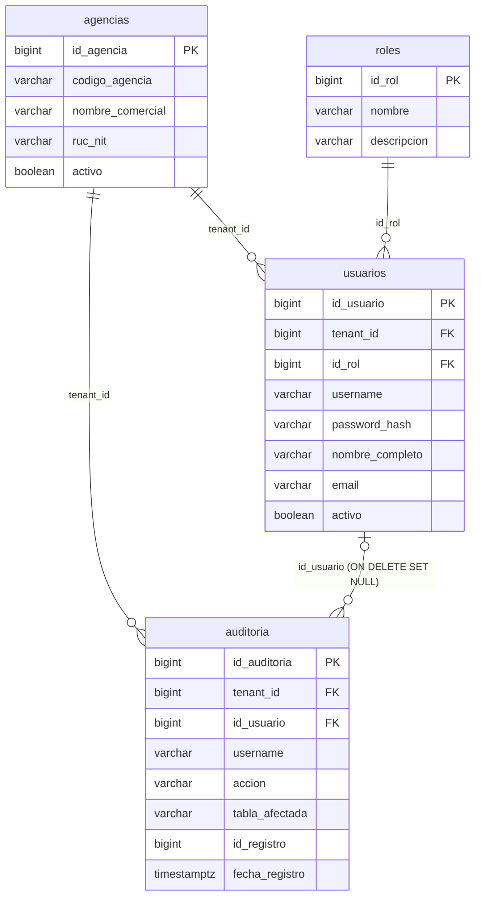
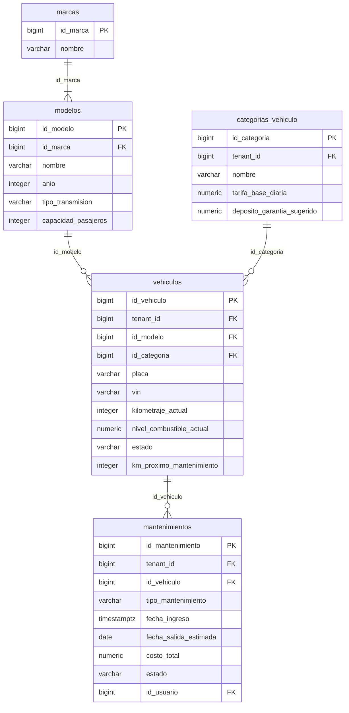
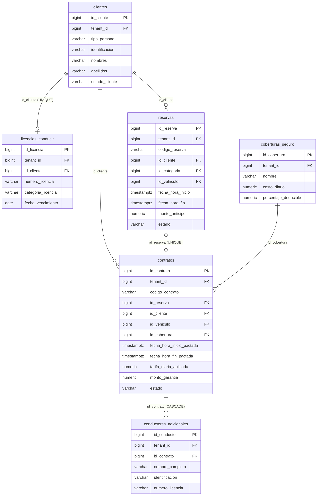
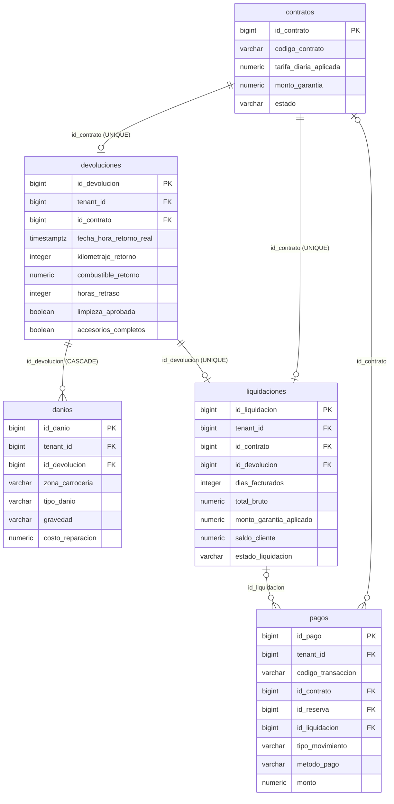

# Modelo Relacional de Base de Datos - AutoRent Pro

Documentación técnica formal del **Modelo Relacional Físico y Lógico** correspondiente al esquema de base de datos implementado en **PostgreSQL 15+** para el sistema **AutoRent Pro**, codificado en [`src/database/migrations/01_create_schema.sql`](file:///C:/Disk_E/UNAN/Proyecto_Integrador_II/agencia_de_autos/src/database/migrations/01_create_schema.sql).

---

## 1. Fundamentos del Diseño Relacional

El modelo relacional del sistema implementa estándares de normalización hasta **Tercera Forma Normal (3FN)** y **Forma Normal de Boyce-Codd (FNBC)**, combinados con optimizaciones para entornos transaccionales multi-sucursal:

* **Arquitectura Multi-Inquilino (Multi-Tenancy con RLS):** Patrón de *Esquema Compartido con Columna Discriminadora* (`tenant_id`), donde todas las tablas operativas aíslan sus tuplas mediante políticas automáticas de Row-Level Security en PostgreSQL vinculadas a la clave primaria de `agencias`.
* **Identificadores Físicos Estandarizados:** Claves primarias auto-incrementales generadas por hardware mediante `BIGINT GENERATED ALWAYS AS IDENTITY`.
* **Integridad Referencial Estricta:** Reglas explícitas de acción ante eliminación:
  * `ON DELETE RESTRICT`: Protege la coherencia del negocio (no se pueden eliminar agencias, vehículos o contratos si existen registros dependientes).
  * `ON DELETE CASCADE`: Borrado en cascada para entidades de composición débil/fuerte (`licencias_conducir`, `conductores_adicionales`, `danios`).
  * `ON DELETE SET NULL`: Pistas de auditoría inmutables (`auditoria.id_usuario`).
* **Restricciones Temporales de Exclusión (GiST):** Uso de la extensión `btree_gist` para crear restricciones de exclusión temporal (`EXCLUDE USING gist`) que imposibilitan a nivel de motor el solapamiento de reservas y contratos para el mismo vehículo.

---

## 2. Diagrama Relacional Físico Global (19 Tablas)

El siguiente diagrama modela la totalidad de las 19 tablas físicas, sus columnas tipadas, claves primarias (`PK`), claves foráneas (`FK`) y las relaciones físicas de dependencia.

```mermaid
---
title: Esquema Físico Relacional PostgreSQL 15+ (19 Tablas)
---
erDiagram
    %% =========================================================================
    %% 0. MODULO MULTI-TENANCY
    %% =========================================================================
    agencias {
        bigint id_agencia PK
        varchar codigo_agencia
        varchar nombre_comercial
        varchar ruc_nit
        varchar telefono
        varchar email
        text direccion
        boolean activo
        timestamptz fecha_creacion
    }

    %% =========================================================================
    %% 1. MODULO DE SEGURIDAD Y USUARIOS (RBAC)
    %% =========================================================================
    roles {
        bigint id_rol PK
        varchar nombre
        varchar descripcion
    }

    usuarios {
        bigint id_usuario PK
        bigint tenant_id FK
        bigint id_rol FK
        varchar username
        varchar password_hash
        varchar nombre_completo
        varchar email
        boolean activo
        timestamptz fecha_creacion
    }

    auditoria {
        bigint id_auditoria PK
        bigint tenant_id FK
        bigint id_usuario FK
        varchar username
        varchar accion
        varchar tabla_afectada
        bigint id_registro
        text detalles
        varchar ip_origen
        timestamptz fecha_registro
    }

    %% =========================================================================
    %% 2. MODULO DE FLOTA Y VEHICULOS
    %% =========================================================================
    marcas {
        bigint id_marca PK
        varchar nombre
    }

    modelos {
        bigint id_modelo PK
        bigint id_marca FK
        varchar nombre
        integer anio
        varchar tipo_transmision
        integer capacidad_pasajeros
    }

    categorias_vehiculo {
        bigint id_categoria PK
        bigint tenant_id FK
        varchar nombre
        text descripcion
        numeric deposito_garantia_sugerido
        numeric tarifa_base_diaria
    }

    vehiculos {
        bigint id_vehiculo PK
        bigint tenant_id FK
        bigint id_modelo FK
        bigint id_categoria FK
        varchar placa
        varchar vin
        varchar color
        integer kilometraje_actual
        numeric nivel_combustible_actual
        varchar estado
        integer km_proximo_mantenimiento
        boolean activo
    }

    %% =========================================================================
    %% 3. MODULO DE CLIENTES Y CONDUCTORES
    %% =========================================================================
    clientes {
        bigint id_cliente PK
        bigint tenant_id FK
        varchar tipo_persona
        varchar identificacion
        varchar nombres
        varchar apellidos
        varchar telefono
        varchar email
        text direccion
        varchar estado_cliente
        timestamptz fecha_registro
    }

    licencias_conducir {
        bigint id_licencia PK
        bigint tenant_id FK
        bigint id_cliente FK
        varchar numero_licencia
        varchar categoria_licencia
        date fecha_emision
        date fecha_vencimiento
        varchar pais_emision
    }

    coberturas_seguro {
        bigint id_cobertura PK
        bigint tenant_id FK
        varchar nombre
        text descripcion
        numeric costo_diario
        numeric porcentaje_deducible
    }

    %% =========================================================================
    %% 4. MODULO DE RESERVAS
    %% =========================================================================
    reservas {
        bigint id_reserva PK
        bigint tenant_id FK
        varchar codigo_reserva
        bigint id_cliente FK
        bigint id_categoria FK
        bigint id_vehiculo FK
        timestamptz fecha_hora_inicio
        timestamptz fecha_hora_fin
        numeric monto_anticipo
        varchar estado
        bigint id_usuario FK
        timestamptz fecha_creacion
    }

    %% =========================================================================
    %% 5. MODULO DE CONTRATOS Y OPERACIONES
    %% =========================================================================
    contratos {
        bigint id_contrato PK
        bigint tenant_id FK
        varchar codigo_contrato
        bigint id_reserva FK
        bigint id_cliente FK
        bigint id_vehiculo FK
        bigint id_cobertura FK
        timestamptz fecha_hora_inicio_pactada
        timestamptz fecha_hora_fin_pactada
        timestamptz fecha_hora_salida_real
        integer kilometraje_salida
        numeric combustible_salida
        numeric tarifa_diaria_aplicada
        numeric monto_garantia
        boolean kilometraje_ilimitado
        integer limite_km_diario
        numeric costo_km_excedente
        varchar estado
        bigint id_usuario FK
        timestamptz fecha_creacion
    }

    conductores_adicionales {
        bigint id_conductor PK
        bigint tenant_id FK
        bigint id_contrato FK
        varchar nombre_completo
        varchar identificacion
        varchar numero_licencia
        date fecha_vencimiento_licencia
    }

    %% =========================================================================
    %% 6. MODULO DE DEVOLUCIONES Y DAÑOS
    %% =========================================================================
    devoluciones {
        bigint id_devolucion PK
        bigint tenant_id FK
        bigint id_contrato FK
        timestamptz fecha_hora_retorno_real
        integer kilometraje_retorno
        numeric combustible_retorno
        integer horas_retraso
        boolean limpieza_aprobada
        boolean accesorios_completos
        text observaciones
        bigint id_usuario FK
    }

    danios {
        bigint id_danio PK
        bigint tenant_id FK
        bigint id_devolucion FK
        varchar zona_carroceria
        varchar tipo_danio
        varchar gravedad
        text descripcion
        numeric costo_reparacion
    }

    %% =========================================================================
    %% 7. MODULO DE LIQUIDACIONES Y CONTROL FINANCIERO
    %% =========================================================================
    liquidaciones {
        bigint id_liquidacion PK
        bigint tenant_id FK
        bigint id_contrato FK
        bigint id_devolucion FK
        timestamptz fecha_liquidacion
        integer dias_facturados
        numeric subtotal_renta
        numeric cargos_retraso
        numeric cargos_combustible
        numeric cargos_km_excedente
        numeric cargos_danios
        numeric total_bruto
        numeric monto_garantia_aplicado
        numeric saldo_cliente
        varchar estado_liquidacion
        bigint id_usuario FK
    }

    pagos {
        bigint id_pago PK
        bigint tenant_id FK
        varchar codigo_transaccion
        bigint id_contrato FK
        bigint id_reserva FK
        bigint id_liquidacion FK
        varchar tipo_movimiento
        varchar metodo_pago
        numeric monto
        timestamptz fecha_hora
        varchar referencia
        bigint id_usuario FK
    }

    %% =========================================================================
    %% 8. MODULO DE MANTENIMIENTO
    %% =========================================================================
    mantenimientos {
        bigint id_mantenimiento PK
        bigint tenant_id FK
        bigint id_vehiculo FK
        varchar tipo_mantenimiento
        timestamptz fecha_ingreso
        date fecha_salida_estimada
        timestamptz fecha_salida_real
        integer kilometraje_entrada
        varchar taller_servicio
        text descripcion_trabajo
        numeric costo_total
        varchar estado
        bigint id_usuario FK
    }

    %% Claves Foráneas
    agencias ||--o{ usuarios : "fk_usuarios_agencias (tenant_id)"
    agencias ||--o{ auditoria : "fk_auditoria_agencias (tenant_id)"
    roles ||--o{ usuarios : "fk_usuarios_roles (id_rol)"
    usuarios |o--o{ auditoria : "fk_auditoria_usuarios (id_usuario)"

    marcas ||--|{ modelos : "fk_modelos_marcas (id_marca)"
    modelos ||--o{ vehiculos : "fk_vehiculos_modelos (id_modelo)"
    categorias_vehiculo ||--o{ vehiculos : "fk_vehiculos_categorias (id_categoria)"
    vehiculos ||--o{ mantenimientos : "fk_mantenimientos_vehiculos (id_vehiculo)"
    usuarios ||--o{ mantenimientos : "fk_mantenimientos_usuarios (id_usuario)"

    clientes ||--o| licencias_conducir : "fk_licencias_clientes (id_cliente)"

    clientes ||--o{ reservas : "fk_reservas_clientes (id_cliente)"
    categorias_vehiculo ||--o{ reservas : "fk_reservas_categorias (id_categoria)"
    vehiculos |o--o{ reservas : "fk_reservas_vehiculos (id_vehiculo)"
    usuarios ||--o{ reservas : "fk_reservas_usuarios (id_usuario)"

    reservas |o--o| contratos : "fk_contratos_reservas (id_reserva)"
    clientes ||--o{ contratos : "fk_contratos_clientes (id_cliente)"
    vehiculos ||--o{ contratos : "fk_contratos_vehiculos (id_vehiculo)"
    coberturas_seguro ||--o{ contratos : "fk_contratos_coberturas (id_cobertura)"
    usuarios ||--o{ contratos : "fk_contratos_usuarios (id_usuario)"
    contratos ||--o{ conductores_adicionales : "fk_conductores_contratos (id_contrato)"

    contratos ||--o| devoluciones : "fk_devoluciones_contratos (id_contrato)"
    usuarios ||--o{ devoluciones : "fk_devoluciones_usuarios (id_usuario)"
    devoluciones ||--o{ danios : "fk_danios_devoluciones (id_devolucion)"

    contratos ||--o| liquidaciones : "fk_liquidaciones_contratos (id_contrato)"
    devoluciones ||--o| liquidaciones : "fk_liquidaciones_devoluciones (id_devolucion)"
    usuarios ||--o{ liquidaciones : "fk_liquidaciones_usuarios (id_usuario)"

    contratos |o--o{ pagos : "fk_pagos_contratos (id_contrato)"
    reservas |o--o{ pagos : "fk_pagos_reservas (id_reserva)"
    liquidaciones |o--o{ pagos : "fk_pagos_liquidaciones (id_liquidacion)"
    usuarios ||--o{ pagos : "fk_pagos_usuarios (id_usuario)"
```

---

## 3. Diagramas Modulares del Esquema Relacional

### 3.1. Gobernanza de Seguridad y Aislamiento Multi-Tenant

Control de acceso basado en roles (RBAC) y bitácora forense de transacciones.

---

### 3.2. Catálogo Automotriz, Flota y Control Técnico de Taller

Jerarquía de catálogo vehicular y control de mantenimiento de la flota.

---

### 3.3. Clientes, Pólizas de Seguro, Reservas y Contratos de Alquiler

Esquema del flujo de captación comercial y formalización de alquileres.

---

### 3.4. Cierre Operativo: Devolución, Daños, Liquidación y Cobros

Sub-esquema de recepción física, cálculo de cargos e ingreso de pagos en caja.

---

## 4. Notación Relacional Formal de Codd (Esquemas de Relación)

Representación algebraica de las 19 relaciones del sistema. Las **Claves Primarias (PK)** se identifican con `[PK]` y las **Claves Foráneas (FK)** con su referencia explícita a la relación padre `[FK -> tabla(pk)]`:

1. **`agencias`** (
   `id_agencia` [PK], 
   `codigo_agencia` [UQ], 
   `nombre_comercial`, 
   `ruc_nit` [UQ], 
   `telefono`, 
   `email`, 
   `direccion`, 
   `activo`, 
   `fecha_creacion`
   )

2. **`roles`** (
   `id_rol` [PK], 
   `nombre` [UQ], 
   `descripcion`
   )

3. **`usuarios`** (
   `id_usuario` [PK], 
   `tenant_id` [FK $\rightarrow$ agencias(id_agencia)], 
   `id_rol` [FK $\rightarrow$ roles(id_rol)], 
   `username`, 
   `password_hash`, 
   `nombre_completo`, 
   `email`, 
   `activo`, 
   `fecha_creacion`,
   *[UQ: (tenant_id, username)], [UQ: (tenant_id, email)]*
   )

4. **`auditoria`** (
   `id_auditoria` [PK], 
   `tenant_id` [FK $\rightarrow$ agencias(id_agencia)], 
   `id_usuario` [FK $\rightarrow$ usuarios(id_usuario)], 
   `username`, 
   `accion`, 
   `tabla_afectada`, 
   `id_registro`, 
   `detalles`, 
   `ip_origen`, 
   `fecha_registro`
   )

5. **`marcas`** (
   `id_marca` [PK], 
   `nombre` [UQ]
   )

6. **`modelos`** (
   `id_modelo` [PK], 
   `id_marca` [FK $\rightarrow$ marcas(id_marca)], 
   `nombre`, 
   `anio`, 
   `tipo_transmision`, 
   `capacidad_pasajeros`,
   *[UQ: (id_marca, nombre, anio)]*
   )

7. **`categorias_vehiculo`** (
   `id_categoria` [PK], 
   `tenant_id` [FK $\rightarrow$ agencias(id_agencia)], 
   `nombre`, 
   `descripcion`, 
   `deposito_garantia_sugerido`, 
   `tarifa_base_diaria`,
   *[UQ: (tenant_id, nombre)]*
   )

8. **`vehiculos`** (
   `id_vehiculo` [PK], 
   `tenant_id` [FK $\rightarrow$ agencias(id_agencia)], 
   `id_modelo` [FK $\rightarrow$ modelos(id_modelo)], 
   `id_categoria` [FK $\rightarrow$ categorias_vehiculo(id_categoria)], 
   `placa`, 
   `vin`, 
   `color`, 
   `kilometraje_actual`, 
   `nivel_combustible_actual`, 
   `estado`, 
   `km_proximo_mantenimiento`, 
   `activo`,
   *[UQ: (tenant_id, placa)], [UQ: (tenant_id, vin)]*
   )

9. **`clientes`** (
   `id_cliente` [PK], 
   `tenant_id` [FK $\rightarrow$ agencias(id_agencia)], 
   `tipo_persona`, 
   `identificacion`, 
   `nombres`, 
   `apellidos`, 
   `telefono`, 
   `email`, 
   `direccion`, 
   `estado_cliente`, 
   `fecha_registro`,
   *[UQ: (tenant_id, identificacion)], [UQ: (tenant_id, email)]*
   )

10. **`licencias_conducir`** (
    `id_licencia` [PK], 
    `tenant_id` [FK $\rightarrow$ agencias(id_agencia)], 
    `id_cliente` [FK $\rightarrow$ clientes(id_cliente), UQ], 
    `numero_licencia`, 
    `categoria_licencia`, 
    `fecha_emision`, 
    `fecha_vencimiento`, 
    `pais_emision`,
    *[UQ: (tenant_id, numero_licencia)]*
    )

11. **`coberturas_seguro`** (
    `id_cobertura` [PK], 
    `tenant_id` [FK $\rightarrow$ agencias(id_agencia)], 
    `nombre`, 
    `descripcion`, 
    `costo_diario`, 
    `porcentaje_deducible`,
    *[UQ: (tenant_id, nombre)]*
    )

12. **`reservas`** (
    `id_reserva` [PK], 
    `tenant_id` [FK $\rightarrow$ agencias(id_agencia)], 
    `codigo_reserva`, 
    `id_cliente` [FK $\rightarrow$ clientes(id_cliente)], 
    `id_categoria` [FK $\rightarrow$ categorias_vehiculo(id_categoria)], 
    `id_vehiculo` [FK $\rightarrow$ vehiculos(id_vehiculo)], 
    `fecha_hora_inicio`, 
    `fecha_hora_fin`, 
    `monto_anticipo`, 
    `estado`, 
    `id_usuario` [FK $\rightarrow$ usuarios(id_usuario)], 
    `fecha_creacion`,
    *[UQ: (tenant_id, codigo_reserva)]*
    )

13. **`contratos`** (
    `id_contrato` [PK], 
    `tenant_id` [FK $\rightarrow$ agencias(id_agencia)], 
    `codigo_contrato`, 
    `id_reserva` [FK $\rightarrow$ reservas(id_reserva), UQ], 
    `id_cliente` [FK $\rightarrow$ clientes(id_cliente)], 
    `id_vehiculo` [FK $\rightarrow$ vehiculos(id_vehiculo)], 
    `id_cobertura` [FK $\rightarrow$ coberturas_seguro(id_cobertura)], 
    `fecha_hora_inicio_pactada`, 
    `fecha_hora_fin_pactada`, 
    `fecha_hora_salida_real`, 
    `kilometraje_salida`, 
    `combustible_salida`, 
    `tarifa_diaria_aplicada`, 
    `monto_garantia`, 
    `kilometraje_ilimitado`, 
    `limite_km_diario`, 
    `costo_km_excedente`, 
    `estado`, 
    `id_usuario` [FK $\rightarrow$ usuarios(id_usuario)], 
    `fecha_creacion`,
    *[UQ: (tenant_id, codigo_contrato)]*
    )

14. **`conductores_adicionales`** (
    `id_conductor` [PK], 
    `tenant_id` [FK $\rightarrow$ agencias(id_agencia)], 
    `id_contrato` [FK $\rightarrow$ contratos(id_contrato)], 
    `nombre_completo`, 
    `identificacion`, 
    `numero_licencia`, 
    `fecha_vencimiento_licencia`
    )

15. **`devoluciones`** (
    `id_devolucion` [PK], 
    `tenant_id` [FK $\rightarrow$ agencias(id_agencia)], 
    `id_contrato` [FK $\rightarrow$ contratos(id_contrato), UQ], 
    `fecha_hora_retorno_real`, 
    `kilometraje_retorno`, 
    `combustible_retorno`, 
    `horas_retraso`, 
    `limpieza_aprobada`, 
    `accesorios_completos`, 
    `observaciones`, 
    `id_usuario` [FK $\rightarrow$ usuarios(id_usuario)]
    )

16. **`danios`** (
    `id_danio` [PK], 
    `tenant_id` [FK $\rightarrow$ agencias(id_agencia)], 
    `id_devolucion` [FK $\rightarrow$ devoluciones(id_devolucion)], 
    `zona_carroceria`, 
    `tipo_danio`, 
    `gravedad`, 
    `descripcion`, 
    `costo_reparacion`
    )

17. **`liquidaciones`** (
    `id_liquidacion` [PK], 
    `tenant_id` [FK $\rightarrow$ agencias(id_agencia)], 
    `id_contrato` [FK $\rightarrow$ contratos(id_contrato), UQ], 
    `id_devolucion` [FK $\rightarrow$ devoluciones(id_devolucion), UQ], 
    `fecha_liquidacion`, 
    `dias_facturados`, 
    `subtotal_renta`, 
    `cargos_retraso`, 
    `cargos_combustible`, 
    `cargos_km_excedente`, 
    `cargos_danios`, 
    `total_bruto`, 
    `monto_garantia_aplicado`, 
    `saldo_cliente`, 
    `estado_liquidacion`, 
    `id_usuario` [FK $\rightarrow$ usuarios(id_usuario)]
    )

18. **`pagos`** (
    `id_pago` [PK], 
    `tenant_id` [FK $\rightarrow$ agencias(id_agencia)], 
    `codigo_transaccion`, 
    `id_contrato` [FK $\rightarrow$ contratos(id_contrato)], 
    `id_reserva` [FK $\rightarrow$ reservas(id_reserva)], 
    `id_liquidacion` [FK $\rightarrow$ liquidaciones(id_liquidacion)], 
    `tipo_movimiento`, 
    `metodo_pago`, 
    `monto`, 
    `fecha_hora`, 
    `referencia`, 
    `id_usuario` [FK $\rightarrow$ usuarios(id_usuario)],
    *[UQ: (tenant_id, codigo_transaccion)]*
    )

19. **`mantenimientos`** (
    `id_mantenimiento` [PK], 
    `tenant_id` [FK $\rightarrow$ agencias(id_agencia)], 
    `id_vehiculo` [FK $\rightarrow$ vehiculos(id_vehiculo)], 
    `tipo_mantenimiento`, 
    `fecha_ingreso`, 
    `fecha_salida_estimada`, 
    `fecha_salida_real`, 
    `kilometraje_entrada`, 
    `taller_servicio`, 
    `descripcion_trabajo`, 
    `costo_total`, 
    `estado`, 
    `id_usuario` [FK $\rightarrow$ usuarios(id_usuario)]
    )

---

## 5. Matriz de Integridad Referencial y Reglas de Borrado (Foreign Keys)

| Restricción FK | Tabla Origen | Columna FK | Tabla Destino | Columna PK | Acción ON DELETE | Propósito de Negocio |
| :--- | :--- | :--- | :--- | :--- | :--- | :--- |
| `fk_usuarios_agencias` | `usuarios` | `tenant_id` | `agencias` | `id_agencia` | `RESTRICT` | Impide borrar agencias con personal activo. |
| `fk_usuarios_roles` | `usuarios` | `id_rol` | `roles` | `id_rol` | `RESTRICT` | No permite eliminar perfiles de seguridad en uso. |
| `fk_auditoria_agencias` | `auditoria` | `tenant_id` | `agencias` | `id_agencia` | `RESTRICT` | Integridad de la bitácora multi-tenant. |
| `fk_auditoria_usuarios` | `auditoria` | `id_usuario` | `usuarios` | `id_usuario` | `SET NULL` | Preserva el histórico de auditoría aún si se suprime la cuenta. |
| `fk_modelos_marcas` | `modelos` | `id_marca` | `marcas` | `id_marca` | `RESTRICT` | Garantiza consistencia del catálogo de fabricantes. |
| `fk_categorias_agencias`| `categorias_vehiculo` | `tenant_id` | `agencias` | `id_agencia` | `RESTRICT` | Protege tarifas de las agencias. |
| `fk_vehiculos_agencias` | `vehiculos` | `tenant_id` | `agencias` | `id_agencia` | `RESTRICT` | Protege el inventario de la flota por inquilino. |
| `fk_vehiculos_modelos` | `vehiculos` | `id_modelo` | `modelos` | `id_modelo` | `RESTRICT` | Bloquea el borrado de modelos con unidades asociadas. |
| `fk_vehiculos_categorias`| `vehiculos` | `id_categoria` | `categorias_vehiculo`| `id_categoria` | `RESTRICT` | Vehículo debe pertenecer siempre a una categoría activa. |
| `fk_clientes_agencias` | `clientes` | `tenant_id` | `agencias` | `id_agencia` | `RESTRICT` | Cartera de clientes vinculada al inquilino. |
| `fk_licencias_agencias` | `licencias_conducir` | `tenant_id` | `agencias` | `id_agencia` | `RESTRICT` | Aislamiento tenant para licencias. |
| `fk_licencias_clientes` | `licencias_conducir` | `id_cliente` | `clientes` | `id_cliente` | `CASCADE` | Si se elimina el cliente, se borra su licencia asociada. |
| `fk_coberturas_agencias`| `coberturas_seguro` | `tenant_id` | `agencias` | `id_agencia` | `RESTRICT` | Tarifario de seguros por agencia. |
| `fk_reservas_agencias` | `reservas` | `tenant_id` | `agencias` | `id_agencia` | `RESTRICT` | Aislamiento multi-tenant de reservas. |
| `fk_reservas_clientes` | `reservas` | `id_cliente` | `clientes` | `id_cliente` | `RESTRICT` | Reserva vinculada a cliente existente. |
| `fk_reservas_categorias`| `reservas` | `id_categoria` | `categorias_vehiculo`| `id_categoria` | `RESTRICT` | Reserva debe tener tarifa base de categoría. |
| `fk_reservas_vehiculos` | `reservas` | `id_vehiculo` | `vehiculos` | `id_vehiculo` | `RESTRICT` | Asignación preventiva de unidad (nullable). |
| `fk_reservas_usuarios` | `reservas` | `id_usuario` | `usuarios` | `id_usuario` | `RESTRICT` | Registro trazable de vendedor. |
| `fk_contratos_agencias` | `contratos` | `tenant_id` | `agencias` | `id_agencia` | `RESTRICT` | Gobernanza multi-tenant del contrato legal. |
| `fk_contratos_reservas` | `contratos` | `id_reserva` | `reservas` | `id_reserva` | `RESTRICT` | Vinculación unívoca de contrato a reserva previa. |
| `fk_contratos_clientes` | `contratos` | `id_cliente` | `clientes` | `id_cliente` | `RESTRICT` | Titular del arrendamiento. |
| `fk_contratos_vehiculos`| `contratos` | `id_vehiculo` | `vehiculos` | `id_vehiculo` | `RESTRICT` | Unidad asignada al contrato. |
| `fk_contratos_coberturas`| `contratos`| `id_cobertura`| `coberturas_seguro` | `id_cobertura`| `RESTRICT` | Póliza de seguro obligatoria. |
| `fk_contratos_usuarios` | `contratos` | `id_usuario` | `usuarios` | `id_usuario` | `RESTRICT` | Agente comercial que apertura el contrato. |
| `fk_conductores_agencias`| `conductores_adicionales`| `tenant_id`| `agencias`| `id_agencia`| `RESTRICT` | Aislamiento tenant para conductores. |
| `fk_conductores_contratos`| `conductores_adicionales`| `id_contrato`| `contratos`| `id_contrato`| `CASCADE` | Al cerrarse o suprimirse el contrato, expiran conductores. |
| `fk_devoluciones_agencias`| `devoluciones`| `tenant_id`| `agencias` | `id_agencia` | `RESTRICT` | Aislamiento tenant de actas físicas. |
| `fk_devoluciones_contratos`| `devoluciones`| `id_contrato`| `contratos` | `id_contrato`| `RESTRICT` | Acta de entrega vinculada a su contrato único. |
| `fk_devoluciones_usuarios`| `devoluciones`| `id_usuario`| `usuarios` | `id_usuario` | `RESTRICT` | Inspector técnico responsable de la inspección. |
| `fk_danios_agencias` | `danios` | `tenant_id` | `agencias` | `id_agencia` | `RESTRICT` | Aislamiento tenant para averías. |
| `fk_danios_devoluciones`| `danios` | `id_devolucion`| `devoluciones` | `id_devolucion`| `CASCADE` | Las averías forman parte indisoluble de la devolución. |
| `fk_liquidaciones_agencias`| `liquidaciones`| `tenant_id`| `agencias`| `id_agencia`| `RESTRICT` | Control fiscal multi-tenant. |
| `fk_liquidaciones_contratos`| `liquidaciones`| `id_contrato`| `contratos`| `id_contrato`| `RESTRICT` | Liquidación financiera única por contrato. |
| `fk_liquidaciones_devoluciones`| `liquidaciones`| `id_devolucion`| `devoluciones`| `id_devolucion`| `RESTRICT` | Respaldada por el acta física de inspección. |
| `fk_liquidaciones_usuarios`| `liquidaciones`| `id_usuario`| `usuarios` | `id_usuario` | `RESTRICT` | Agente o cajero que liquida el saldo. |
| `fk_pagos_agencias` | `pagos` | `tenant_id` | `agencias` | `id_agencia` | `RESTRICT` | Aislamiento de tesorería y arqueo de caja. |
| `fk_pagos_contratos` | `pagos` | `id_contrato` | `contratos` | `id_contrato` | `RESTRICT` | Pagos asociados a contrato (anticipo, garantía). |
| `fk_pagos_reservas` | `pagos` | `id_reserva` | `reservas` | `id_reserva` | `RESTRICT` | Anticipos cobrados por reserva. |
| `fk_pagos_liquidaciones`| `pagos` | `id_liquidacion`| `liquidaciones`| `id_liquidacion`| `RESTRICT` | Cobro de saldo final o reembolso de garantía. |
| `fk_pagos_usuarios` | `pagos` | `id_usuario` | `usuarios` | `id_usuario` | `RESTRICT` | Cajero que procesa la transacción financiera. |
| `fk_mantenimientos_agencias`| `mantenimientos`| `tenant_id`| `agencias`| `id_agencia`| `RESTRICT` | Aislamiento tenant de órdenes de taller. |
| `fk_mantenimientos_vehiculos`| `mantenimientos`| `id_vehiculo`| `vehiculos`| `id_vehiculo`| `RESTRICT` | Historial de servicio técnico de la unidad. |
| `fk_mantenimientos_usuarios`| `mantenimientos`| `id_usuario`| `usuarios` | `id_usuario` | `RESTRICT` | Inspector o jefe de taller que autoriza el servicio. |

---

## 6. Índices Estratégicos de Base de Datos y Aislamiento RLS

Para garantizar tiempos de respuesta en milisegundos y alto desempeño en consultas filtradas por la columna discriminadora `tenant_id`, se crearon 14 índices B-Tree de cobertura:

| Nombre del Índice | Tabla | Columnas Indexadas | Propósito de Rendimiento |
| :--- | :--- | :--- | :--- |
| `idx_usuarios_tenant` | `usuarios` | `(tenant_id)` | Aislamiento RLS y login por inquilino. |
| `idx_categorias_tenant` | `categorias_vehiculo` | `(tenant_id)` | Catálogo de tarifas por sucursal. |
| `idx_vehiculos_tenant` | `vehiculos` | `(tenant_id)` | Filtro rápido de flota disponible. |
| `idx_clientes_tenant` | `clientes` | `(tenant_id)` | Búsqueda rápida de clientes por inquilino. |
| `idx_licencias_tenant` | `licencias_conducir` | `(tenant_id)` | Validación de vigencia de licencias. |
| `idx_coberturas_tenant` | `coberturas_seguro` | `(tenant_id)` | Tarifas de pólizas activas. |
| `idx_reservas_tenant` | `reservas` | `(tenant_id)` | Consulta de reservas por sucursal. |
| `idx_contratos_tenant` | `contratos` | `(tenant_id)` | Búsqueda de contratos activos y liquidaciones. |
| `idx_conductores_tenant` | `conductores_adicionales`| `(tenant_id)` | Verificación en carretera de conductores autorizados. |
| `idx_devoluciones_tenant` | `devoluciones` | `(tenant_id)` | Actas de recepción física en taller. |
| `idx_danios_tenant` | `danios` | `(tenant_id)` | Reporte de siniestralidad y costos de reparación. |
| `idx_liquidaciones_tenant`| `liquidaciones` | `(tenant_id)` | Cierres de caja y estados financieros. |
| `idx_pagos_tenant` | `pagos` | `(tenant_id)` | Conciliación de tesorería y arqueo diario. |
| `idx_mantenimientos_tenant`| `mantenimientos`| `(tenant_id)` | Control de vehículos en taller mecánico. |
| `idx_auditoria_tenant` | `auditoria` | `(tenant_id)` | Trazabilidad de seguridad multi-tenant. |
| `idx_auditoria_fecha` | `auditoria` | `(fecha_registro DESC)` | Ordenación cronológica de logs de auditoría. |
| `idx_auditoria_usuario` | `auditoria` | `(id_usuario)` | Auditoría forense por cuenta de usuario. |

---

*Archivo de código fuente Mermaid puro disponible en:* [Modelo_Relacional.mmd](file:///C:/Disk_E/UNAN/Proyecto_Integrador_II/agencia_de_autos/docs/diagrams/modelo_relacional/Modelo_Relacional.mmd)
